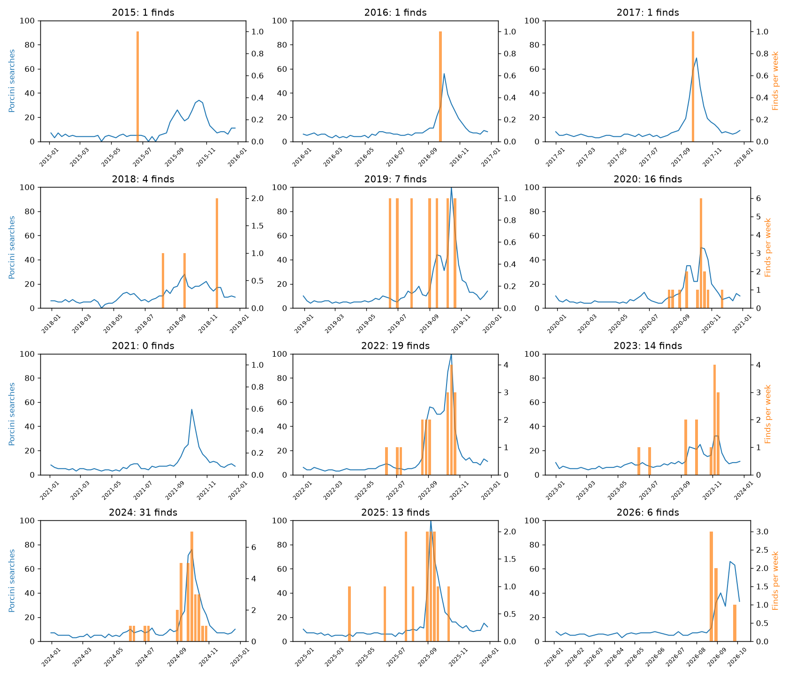

# P1c public signs of when porcini come up in Tuscany

Issue #17.

## Question

Can public signs that reveal no picking spots show the weeks when porcini
come up in Tuscany?

## Answer

Google searches for "porcini" in Tuscany show the weeks of the main autumn
flush. In 5 of 7 years with enough finds, the week with the most searches fell
within 14 days of the middle find date of that year. The median gap was 5 days.
A fixed calendar, built from the average searches of the other years, lines up
in only 2 of 7 years, with a median gap of 29 days. So the searches follow the
real timing of each year: early September in 2025, mid October in 2022, early
November in 2023.

The weekly numbers move together only loosely. Searches peak once a season,
while finds are spread over summer and autumn. Searches are a sign that people
are out picking. They do not prove that porcini were there, and they say
nothing about where.

Wholesale prices and forum posts gave nothing usable.

None of this can go into the app. Trends has no open API and cannot be
scraped. Tuscany is its smallest weekly area, while the season differs between
places inside it. Searches also rise with the finds or a week later, too late
to warn anyone. At most, searches can check during development whether a
weather model gets the season timing right for Tuscany in past years.

## Candidate signs

| Sign | Public data | Terms | Used |
|---|---|---|---|
| Google Trends, "porcini" and "funghi porcini", Tuscany | Yes. Weekly values from 0 to 100 for windows of up to 5 years, from the CSV button on the Trends website. | Google Trends terms of service. Google has no open Trends API: the official one is a closed test, and libraries such as pytrends scrape the site, which this issue rules out. | Yes |
| Wholesale price of fresh porcini, Florence market | The Florence chamber of commerce publishes a weekly price list for the Novoli wholesale market, based on Mercafir daily lists. It has a line for "Funghi porcini". The line is empty in every list checked, including the week of 28 October to 3 November 2019, the peak of that season. Only cultivated button mushrooms get a price. ISMEA, the national farm market agency, has no porcini series. | Free to read online. Reuse needs written permission from the Florence chamber of commerce. | No. No prices exist. |
| Dates of find reports in an Italian mushroom forum | Not checked. The issue asks to contact the forum first, and nobody has written to a forum yet. | Unknown | No |

## What was done

- Search interest comes from three CSV exports of the Trends website, saved in
  `experiments/p1c_flush_signs/trends_exports/`. The area is Tuscany, Google
  code IT-52. The windows run from 1 January 2015 to 31 December 2019, from 1
  January 2020 to 31 December 2024, and from 1 January 2025 to 10 October 2026.
  The files were downloaded on 11 October 2026. Each window has one value per
  week, scaled so that its busiest week is 100. The run record lists each file
  with its link, terms, area, dates and download date.
- Finds come from the P1 run `20261011T075009Z-796984`. The comparison uses
  the 80 reliable finds and the 33 timing finds from P1b in the home area,
  113 in all. The home area is Tuscany plus the strip of the Emilia Apennines
  next to it. Each find is counted in the week, Sunday to Saturday, that holds
  its date.
- Years with at least 5 finds are compared: 2019, 2020, 2022, 2023, 2024,
  2025 and 2026. 2021 has no finds. The years before 2018 have one find each.
- For each year, the script measures three things:
  - How closely searches and finds rise and fall together over the 52 weeks.
    This is a rank correlation: 1 means the same order of weeks, 0 means no
    link.
  - The gap in days between the busiest search week from June to November
    and the middle find date. A positive gap means the searches peak after
    the finds.
  - The same two measures for a simple guess. The guess replaces this year's
    searches with the average of the same week in all other years. It shows
    how much a fixed "porcini come in autumn" calendar already explains.
- Uncertainty ranges come from redrawing the 7 years at random 1,000 times with
  seed 42.
- The searches were also moved up to 4 weeks earlier and later against the
  finds. This shows whether they run ahead of or behind the finds.

## Results

Each panel shows weekly "porcini" searches as a blue line and weekly finds as
orange bars.



| Sign | Years lining up | Calendar guess lining up | Median gap, days | Calendar guess median gap, days | Weekly match | Calendar guess weekly match | Best move, days |
|---|---|---|---|---|---|---|---|
| porcini | 5 of 7 | 2 of 7 | 5 | 29 | 0.42, range 0.36 to 0.50 | 0.39, range 0.33 to 0.46 | 7 later, range 0 to 28 |
| funghi porcini | 5 of 7 | 2 of 7 | 10 | 25 | 0.39, range 0.30 to 0.49 | 0.35, range 0.28 to 0.43 | 0, range 0 to 21 |

"porcini" searches by year:

| Year | Finds | Middle find date | Search peak week | Gap, days | Calendar guess gap, days |
|---|---|---|---|---|---|
| 2019 | 7 | 3 September | 13 October | 43 | 29 |
| 2020 | 16 | 13 October | 11 October | 1 | -13 |
| 2022 | 19 | 9 October | 16 October | 10 | -4 |
| 2023 | 14 | 4 November | 5 November | 4 | -31 |
| 2024 | 31 | 27 September | 29 September | 5 | 19 |
| 2025 | 13 | 6 September | 7 September | 4 | 39 |
| 2026 | 6 | 30 August | 20 September | 24 | 31 |

- The two years that miss have early finds that pull the middle date into
  summer. In 2019, three of the seven finds are from June and July. In 2026 the
  season is still running, and the last search week in the export starts on 4
  October.
- Searches run about the same time as the finds or up to a week later. The
  weekly match is highest when searches are moved 7 days later, 0.44 against
  0.42 with no move. The range runs from 0 to 28 days, so the lag is not
  pinned down.
- The weekly match of this year's searches beats the calendar guess by a small
  margin, and the ranges overlap. Most of the weekly match comes from the
  season itself. The peak week is where this year's searches add information.
- "funghi porcini" gives the same picture with lower numbers. It is mostly a
  subset of "porcini" searches.

## Limits

- Searches measure people, not mushrooms. A search peak can follow news of a
  good season, recipes or festivals as well as real finds. The finds also come
  from people who went out to pick, so both series partly measure the same
  activity.
- Trends values are relative. Each export is scaled to its own busiest week,
  so a value of 50 in 2017 and 50 in 2023 are not the same number of searches.
  The comparison works within each year and does not use the level.
- Seven years with 6 to 31 finds each is a small sample. One or two years can
  change "5 of 7" to "4 of 7".
- Tuscany is the smallest area Trends gives for a weekly series over several
  years. The searches cannot tell the Apennines from the coast.

## Recommendation

- Use weekly "porcini" searches in Tuscany as a check of season timing when
  testing weather. A weather signal that predicts the week of the main flush
  should agree with the search peak, within about two weeks. This works for
  years with few or no finds, such as 2021 and the years before 2018.
- Do not use searches as find dates, as find counts, or to say that a week had
  no porcini. They show the main autumn flush and miss the small summer one.
- Drop wholesale prices. The Florence list has a porcini line with no prices,
  and its terms forbid reuse without permission.
- Forum dates stay untested. They need someone to write to a forum and ask
  for permission. Do this only if the search check is not enough.
- The stop rule does not apply: the search peak lines up with the finds in
  most years.

## How to run again

```bash
uv run sporameteo run p1c_flush_signs
```

The script reads the saved Trends exports and the P1 find tables, and writes:

- `reports/p1c_weekly_series.csv`: one row per week with both search values
  and the reliable, timing and total find counts.
- `reports/p1c_by_year.csv`: the measures for each sign and year.
- `reports/p1c_summary.csv`: the measures over all years, with uncertainty
  ranges.
- `reports/p1c_shifts.csv`: the weekly match when searches are moved 4 weeks
  earlier to 4 weeks later.
- `reports/p1c_flush_signs.png`: the plot above.

To fetch newer search data, open each link in `experiments/p1c_flush_signs/config.toml`, press the
CSV button under "Interest over time", replace the file in `trends_exports/`
and update `download_date`. The run takes about 2 seconds.

Run record: [`reports/runs/p1c_flush_signs/20261011T080539Z-692d26.json`](runs/p1c_flush_signs/20261011T080539Z-692d26.json)
